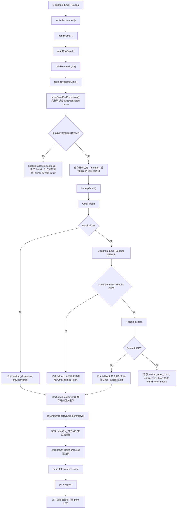
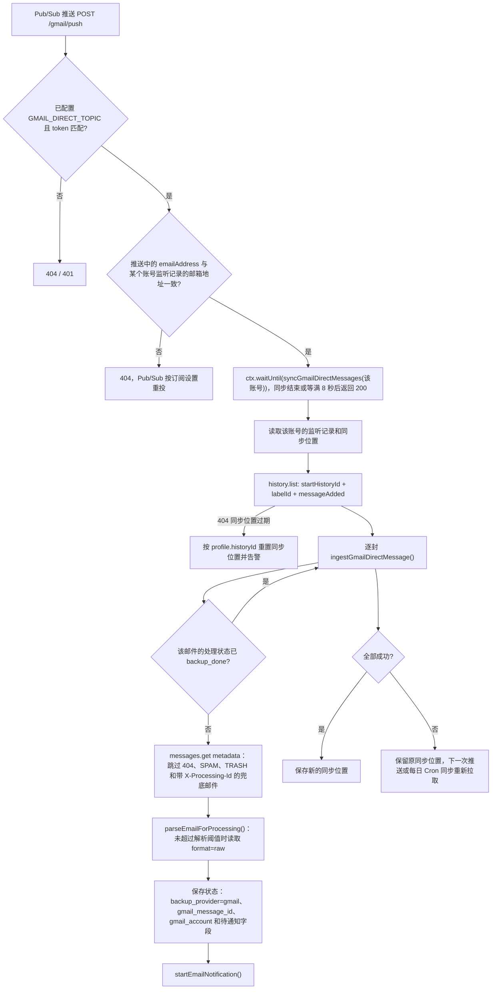
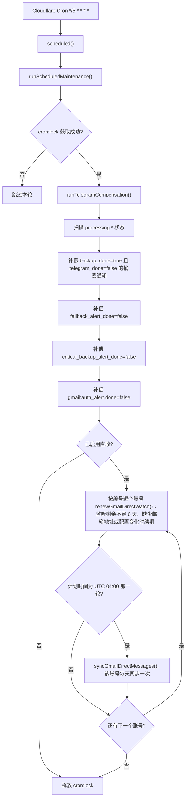

# 架构与代码地图

## 顶层入口

| 文件 | 责任 |
|------|------|
| `src/index.ts` | Cloudflare Worker export，暴露 `fetch`、`email`、`scheduled` |
| `src/router.ts` | Hono HTTP 路由注册 |
| `src/handlers/email.ts` | Email Routing 入站邮件处理主入口 |
| `src/handlers/scheduled.ts` | Cron Trigger 入口 |
| `src/handlers/telegram-callback.ts` | Telegram inline button callback webhook |
| `src/handlers/gmail-push.ts` | Gmail 直收通知的 Pub/Sub 推送入口，校验 token、按推送中的邮箱地址确定账号并同步该账号，同步结束或等满 8 秒后确认 |
| `src/handlers/health.ts` | JSON 健康检查，只证明 HTTP 入口可响应 |

## 主流程

关键点：`backupEmail()` 在 `ctx.waitUntil()` 之前执行。备份失败会影响 Email Routing retry；摘要或 Telegram 失败只写状态，不应让整封邮件重试。

入站邮件带格式合法的 `X-Processing-Id` 邮件头（`v1:` 或 `v2raw:` 加 64 位十六进制），或 SMTP 收件地址等于 `BACKUP_EMAIL_TO` 时，视为本项目发出的兜底邮件被转回本 Worker。此时由 `backupFallbackLoopback()` 只写 Gmail，不发送兜底邮件、不写处理状态、不请求 AI、不发送摘要通知，并发送“兜底邮件被转回本 Worker”告警。告警按处理编号和 Gmail 结果去重；Gmail 写入失败时抛错拒收这封副本。

邮件入口以 Cloudflare `message.to`（SMTP `RCPT TO`）作为本次实际投递的收件地址，写入处理状态的 `to`，并在创建或重建通知缓存时写入缓存的 `to`。摘要首行、原文查看、Cron 补偿及“返回摘要”使用状态或缓存里保存的 `to`，不回头解析邮件头 `To`。邮件头 `To` 缺失、为空地址组或包含其他收件人时也适用。解析出的邮件头和原始 MIME 保持原样。

有 Message-ID 时沿用 `v1:` 处理编号。缺少 Message-ID 时，`v2raw:` 编号由原件哈希、SMTP 收件地址和发件地址共同计算；相同原件投递到不同地址时分别备份和通知，同一投递重试时复用状态。

供应商发送与 KV 状态保存分别处理异常。供应商确认成功后即停止备份链；状态保存失败记录 `backup_state_save_failed`，通知阶段保存状态时会再次带上已确认的备份结果。处理状态、邮件缓存和消息映射遇到 KV 写入 429 时等待 1 秒，仅重试一次。

通知缓存 ID 在首次处理状态中固定；正文缓存于原件备份完成后、进入后台摘要前保存。邮件重投时复用已有缓存，保留摘要及摘要结果；首次准备缓存失败时，通知入口会再次尝试。Cron 只为 `backup_done=true` 且 `telegram_done=false` 的邮件补偿摘要通知，并调用与首次通知相同的实现：缓存已有摘要时复用，只有正文时重新生成。缓存中的 `summary` 保存摘要结果，便于中断后恢复模型、成功标记及错误原因。解析失败或超过解析阈值时直接生成占位通知，不调用 AI；可读正文由 `buildReadableEmailBody()` 生成：默认使用纯文本部分；纯文本长度不到 HTML 转换后文本的一半时改用 HTML 文本，避免纯文本部分只有签名或占位文字时丢失正文。可读正文为空时仍以发件人、收件人、主题和时间请求摘要。摘要输入由 `buildSummaryInputText()` 生成，最多保留前 40000 个字符，首次通知、Cron 补偿和「返回摘要」共用这一上限；`buildSummaryPrompt()` 另将收件人占位符限制在 1000 个字符内。正文缓存仍保存完整可读正文。

首次通知或 Cron 补发取得 Telegram 消息编号后，映射或完成状态写入失败会保存该编号。后续重投、Cron 只修复该消息的映射和状态，不重新发送；修复本身不依赖正文缓存。单封邮件的补偿异常会记录日志，继续扫描其他邮件。备份告警和 Gmail 授权告警分别按自己的状态补偿；备份已经成功时不再补发全部备份失败告警，计数和终止条件见 [运维说明](operations.md#cron-和补偿)。

## Gmail 直收流程

直接投递到 Gmail、不经过 Email Routing 的邮件，由 Gmail 过滤器按 `deliveredto:` 加标签，`users.watch` 只监听该标签并发布到 Pub/Sub。Worker 用 `messages.insert` 写入的备份没有 `Delivered-To` 邮件头，不会被过滤器选中。设置步骤见 [Gmail 直收通知](../gmail-direct-setup.md)。

直收支持多个 Gmail 账号，账号以编号标识。`getGmailDirectConfig()` 在设置了 `GMAIL_DIRECT_TOPIC` 时返回账号列表：账号 1 固定在首位，其后是 `Env` 中每个 `GMAIL_REFRESH_TOKEN_<编号>`（编号不小于 2）按数值排序。账号 1 使用不带编号的变量、KV 键和处理编号，与主备份共用 refresh token；其他账号由 `gmailAccountVar()` 拼出 `_<编号>` 变量名，KV 键和处理编号带 `:<编号>`。所有账号共用 OAuth 客户端、Pub/Sub 主题、推送订阅和推送 token，access token 按账号分别缓存。

Gmail 推送体的 `message.data` 是 base64 编码的 JSON，包含发生变化的 `emailAddress` 和 `historyId`。`findGmailDirectAccount()` 按不区分大小写的邮箱地址逐个比对各账号监听记录中的 `emailAddress`，找到后只同步该账号；`historyId` 不使用，实际新增邮件以保存的同步位置为准。监听记录中的邮箱地址由 Cron 建立监听时调用 `getProfile` 写入，记录缺少地址时下一轮 Cron 会重新建立监听。推送体无法解析或没有匹配的账号时返回 404，Pub/Sub 按订阅设置重投。

账号 1 的直收邮件处理编号为 `gmail:<Gmail 消息 ID>`，其他账号为 `gmail:<编号>:<Gmail 消息 ID>`。收件地址取第一个 `Delivered-To` 邮件头，`rawSize` 取 Gmail 的 `sizeEstimate`。状态写入 `backup_done=true`、`backup_provider=gmail`、`gmail_account`，通知成功后 `msgmap` 保存 `gmailAccount`，「删邮件+消息」据此在对应账号中移入垃圾箱；没有 `gmailAccount` 的映射按账号 1 处理。摘要、Telegram 发送、Cron 补偿和按钮与域名邮件共用同一实现。整条链路对 Gmail 只读。匹配到账号后，推送入口等同步结束再返回 200，最多等待 8 秒（`PUSH_SYNC_WAIT_MS`），未完成的部分留在后台继续；同步失败时也返回 200，Pub/Sub 不会因此重投。摘要通知由同步通过 `ctx.waitUntil()` 发起，与同步共用响应后 30 秒的后台时间，入口先等同步结束，通知就有完整的 30 秒。Cron 在计划时间为 UTC 04:00（台北时间 12:00）的那一轮也逐个账号调用 `syncGmailDirectMessages()`，从读取监听和同步位置开始执行同样的流程，直收邮件间隔很长时同步位置不会因只靠推送更新而过期。

## 定时补偿流程

## HTTP 路由

| 路由 | 文件 | 说明 |
|------|------|------|
| `GET /health` | `src/handlers/health.ts` | JSON 健康检查，只证明 HTTP 入口可响应，不检查发信绑定或 Secrets |
| `POST /telegram/webhook` | `src/handlers/telegram-callback.ts` | Telegram callback webhook，需要 `TG_WEBHOOK_SECRET` |
| `POST /gmail/push` | `src/handlers/gmail-push.ts` | Pub/Sub 推送入口；未配置 `GMAIL_DIRECT_TOPIC` 时返回 404，查询参数 `token` 与 `GMAIL_DIRECT_PUSH_SECRET` 不一致时返回 401，推送中的邮箱地址没有匹配的账号时返回 404 |

摘要消息提供「原文」按钮；Gmail 主备份成功或来自 Gmail 直收时另有「删邮件+消息」。点「原文」后当前消息改为可读正文，并出现「返回摘要」。「返回摘要」只更新当前 Telegram 消息，不写回 KV 缓存。完整排版与附件在备份邮箱查看。

## 核心服务模块

| 模块 | 责任 |
|------|------|
| `processing-id.ts` | 从 Message-ID、收件人、Date、发件人、raw fallback 构造稳定处理 ID |
| `processing-state.ts` | `processing:<id>` 状态读写、TTL、阶段字段合并 |
| `kv-write.ts` | 处理状态、邮件缓存及消息映射的 KV 429 延迟重试 |
| `mime-parser.ts` | 两条入口共用的 `parseEmailForProcessing()`：解析阈值判断、postal-mime 解析与 degraded parse |
| `raw-email.ts` | 读取原始邮件 bytes |
| `backup-orchestrator.ts` | Gmail -> Cloudflare Email Sending -> Resend 备份链路 |
| `gmail-auth.ts` | 按账号获取 Gmail OAuth access token 并分别缓存在内存中 |
| `gmail-api.ts` | 按账号发起 Gmail API 请求、401 后强制刷新 token 重试一次、错误原因解析 |
| `gmail-backup.ts` | Gmail `messages.insert`（multipart media upload，固定写入账号 1）和按账号 `trash` |
| `gmail-direct.ts` | Gmail 直收：发现直收账号、按推送邮箱地址匹配账号、逐账号 `users.watch` 续期、`history.list` 增量同步、读取邮件并进入通知 |
| `base64url.ts` | Base64 编码与 Gmail `raw` 字段的 base64url 解码 |
| `cloudflare-email-fallback.ts` | Cloudflare Email Sending 兜底，附带原始 MIME 附件 |
| `resend-fallback.ts` | Resend 兜底，附带原始 MIME 附件 |
| `fallback-email-content.ts` | 两条兜底共用的主题、纯文本和 HTML 默认值 |
| `notification-orchestrator.ts` | 待通知状态字段、准备正文缓存并启动后台通知；基于预存正文生成摘要、更新缓存、发送 Telegram、合并保存结果 |
| `telegram-compensation.ts` | Cron 扫描失败状态并补偿通知/告警 |
| `email-cache.ts` | `email:<uuid>` 缓存、`msgmap:<messageId>` 映射 |
| `telegram.ts` | Telegram Bot API `sendMessage` / `editMessageText`（`parse_mode: HTML`）、callback response 和 inline keyboard 构造 |
| `email-summary.ts` | 按 `SUMMARY_PROVIDER` 分发到通用 OpenAI 兼容接口、OpenRouter 或 Gemini |
| `openai-summary.ts` / `chat-completions.ts` | 通用 Chat Completions 请求、参数透传及共用响应解析 |
| `openrouter-summary.ts` | OpenRouter Chat Completions 请求、ZDR 降级、摘要响应解析 |
| `gemini-summary.ts` | Gemini `generateContent` 请求（固定低思考）、摘要响应解析 |
| `summary-request.ts` | 三种摘要模式共用的超时、重试次数、可重试错误判断、`Retry-After` 解析及错误详情脱敏 |
| `summary-prompt.ts` | 默认中文摘要 prompt 和环境变量覆盖 |
| `reliability-alerts.ts` | Gmail fallback、critical backup、兜底回环、Gmail auth、Gmail 直收监听续期及同步位置重置告警 |
| `config.ts` | 环境变量读取与必填校验，Gmail 账号编号与变量名的对应 |
| `logging.ts` | 结构化日志输出 |
| `error-reason.ts` | Gmail 与 Resend 错误原因的格式校验 |
| `text-limit.ts` | 按字素边界限长，供 Telegram 发送和摘要输入共用 |

## KV key 约定

| Key / 前缀 | TTL | 用途 |
|------------|-----|------|
| `processing:<processingId>` | 每次写入后 24h | 邮件处理阶段状态、attempt、备份/摘要/Telegram 标记；补偿仍在更新时会续期 |
| `email:<uuid>` | 7d | 通知恢复和 Telegram 原文查看用的正文、摘要文本、摘要结果及 metadata；UUID 在首次处理状态中确定 |
| `msgmap:<telegramMessageId>` | 7d | Telegram message -> email cache / Gmail message 映射；直收邮件另存 Gmail 账号编号 |
| `gmail:auth_alert` | 无过期时间 | Gmail auth 失效告警状态；Gmail 主备份再次成功时删除 |
| `cron:lock` | 默认 240s | Cron 防重入锁 |
| `telegram-compensation:final:*` | 7d | 补偿最终失败 alert dedupe |
| `fallback-loopback:alert:<processingId>:<gmail_done\|gmail_failed>` | 7d | 兜底回环告警 dedupe，同一封副本重投时同一结果只告警一次 |
| `gmail-direct:watch`、`gmail-direct:<编号>:watch` | 无过期时间 | 账号 1 及其他编号账号的直收监听：主题、标签名、标签 ID、邮箱地址、到期时间和建立监听时的 `historyId` |
| `gmail-direct:cursor`、`gmail-direct:<编号>:cursor` | 无过期时间 | 对应账号的直收同步位置（`historyId`），推送或每日 Cron 同步成功后更新；缺失时从该账号监听记录的 `historyId` 开始 |
| `gmail-direct:watch_alert`、`gmail-direct:<编号>:watch_alert` | 24h | 对应账号的监听续期失败告警 dedupe，每天最多一次 |

## 状态字段阅读法

`processing:<id>` 保存邮件处理状态，也包含邮件元信息。排障常用字段：

- `backup_done` / `backup_provider` / `gmail_message_id` / `gmail_account` / `fallback_message_id`
- `backup_error` / `backup_error_chain`
- `fallback_alert_done` / `critical_backup_alert_done`
- `summary_done` / `summary_error` / `summary_error_detail` / `summary_privacy_downgraded` / `summary_fallback_model_used` / `summary_model`
- `telegram_done` / `telegram_stage` / `telegram_error` / `telegram_attempts` / `telegram_next_retry_at`
- `parse_done` / `parse_skipped_reason` / `rawSize` / `maxParseBytes`
- `attempt_count` / `created_at` / `updated_at`

不要把 KV 中的完整值复制进文档或回复；排障证据只记录字段名、布尔值、计数、provider 名、sanitized reason 和 sanitized detail。
