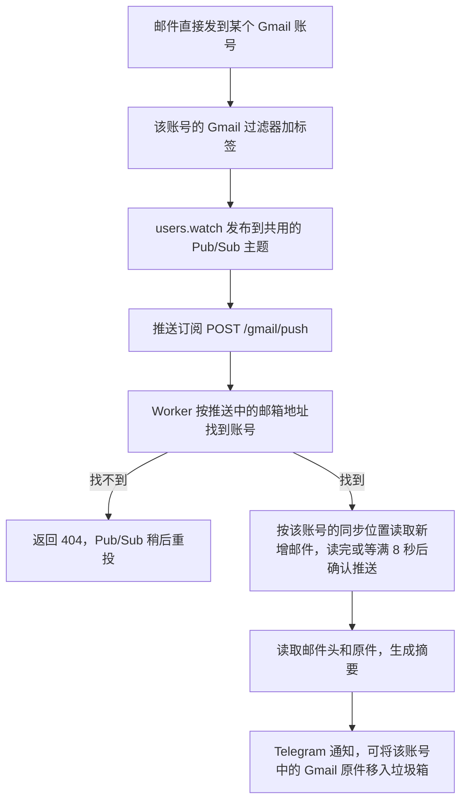

# Gmail 直收通知（可选）

有些服务不接受域名邮箱，只能填写 Gmail 地址。这类邮件直接投递到 Gmail，不经过 Email Routing。启用本功能后，Gmail 通过 Google Cloud Pub/Sub 推送变化通知，Worker 读取新邮件，沿用域名邮件的摘要、Telegram 通知和「删邮件+消息」按钮。原件已经在 Gmail 中，这条链路只读取，不再写入备份。

可以同时监听多个 Gmail 账号。账号 1 是 Gmail 主备份写入的账号，第 2 个起的账号只用于直收通知，按 [添加更多 Gmail 账号](#添加更多-gmail-账号) 配置。

## 工作方式

Worker 用 `messages.insert` 写入的备份没有 `Delivered-To` 邮件头；Gmail 经 SMTP 收到的邮件带有 `Delivered-To: <Gmail 地址>`。Gmail 过滤器按 `deliveredto:` 给直收邮件加标签，Worker 只监听这个标签，备份邮件不会触发通知。



推送内容只用来确定账号和唤醒同步。Cron 建立监听时记录每个账号的邮箱地址，推送到达时按地址找到账号，只同步这一个账号。Worker 按 Gmail 历史记录逐封处理新增邮件，已处理的邮件按处理状态跳过；处理失败时同步位置不前进，下一次推送会重新拉取。Cron 每天台北时间 12:00 也逐个账号同步一次，直收邮件相隔很久时同步位置仍会持续更新，处理失败的邮件最晚在下一个 12:00 重试。这条链路不调用 Gmail 的写入接口，处理邮件不会引发新的推送循环。

所有账号共用同一个 OAuth 客户端（`GMAIL_CLIENT_ID`、`GMAIL_CLIENT_SECRET`）、Pub/Sub 主题、推送订阅和推送 token。每个账号单独提供 refresh token 和过滤器标签名称。

## 准备

- 已按 [Gmail OAuth 设置](gmail-oauth-setup.md) 完成授权；现有 `gmail.modify` 权限可以读取邮件和建立监听，无需重新授权。
- OAuth 客户端所在的 Google Cloud 项目需要关联结算账号，Pub/Sub 才能使用。每封直收邮件只产生几条 1 KB 级别的推送，通常在 Pub/Sub 每月免费额度内，实际费用以 Google Cloud 账单为准。
- 已安装并登录 `gcloud`，或在 Google Cloud Console 中完成同样的操作。

下文 `YOUR_GCP_PROJECT_ID`、`YOUR_TOPIC`、`YOUR_SUBSCRIPTION`、`YOUR_GMAIL_ADDRESS`、`YOUR_GMAIL_LABEL` 和 Worker 地址均为占位符，替换为自己的值，不要提交到公开仓库。

## 1. 创建 Gmail 过滤器

1. 在 Gmail 搜索框输入 `deliveredto:YOUR_GMAIL_ADDRESS`，打开搜索选项，选择「创建过滤器」。
2. 勾选「应用标签」，新建一个标签，例如 `YOUR_GMAIL_LABEL`。嵌套标签的名称包含父级，例如 `父标签/子标签`。
3. 保存过滤器。过滤器只作用于之后收到的邮件。

被 Gmail 判为垃圾邮件，或被其他过滤器直接删除的直收邮件不会通知。

## 2. 创建 Pub/Sub 主题和推送订阅

先在当前终端生成推送 token，保存在 shell 变量中，第 3 步写入 Secret 时继续使用，不在屏幕上显示：

```bash
GMAIL_DIRECT_PUSH_SECRET=$(openssl rand -hex 32)
```

```bash
gcloud services enable pubsub.googleapis.com --project YOUR_GCP_PROJECT_ID
```

```bash
gcloud pubsub topics create YOUR_TOPIC --project YOUR_GCP_PROJECT_ID
```

允许 Gmail 向该主题发布通知：

```bash
gcloud pubsub topics add-iam-policy-binding YOUR_TOPIC --project YOUR_GCP_PROJECT_ID --member serviceAccount:gmail-api-push@system.gserviceaccount.com --role roles/pubsub.publisher
```

创建推送订阅。重试间隔为 10 至 600 秒指数退避，未确认的通知最多保留 10 分钟；直收邮件可能很久才有一封，订阅设为永不过期。确认期限保持默认的 10 秒，推送入口最多等待 8 秒就会响应：

```bash
gcloud pubsub subscriptions create YOUR_SUBSCRIPTION --project YOUR_GCP_PROJECT_ID --topic YOUR_TOPIC --push-endpoint "https://<你的 Worker 地址>/gmail/push?token=${GMAIL_DIRECT_PUSH_SECRET}" --min-retry-delay 10s --max-retry-delay 600s --message-retention-duration 10m --expiration-period never
```

推送地址中的 token 会保存在订阅配置中，也可能出现在 Cloudflare 请求日志里。分享订阅配置或日志前先检查；泄露后更换 Secret，并用 `gcloud pubsub subscriptions modify-push-config` 更新推送地址。

## 3. 配置 Worker

在本机 `wrangler.jsonc` 的 `vars` 中加入：

```json
{
  "GMAIL_DIRECT_TOPIC": "projects/YOUR_GCP_PROJECT_ID/topics/YOUR_TOPIC",
  "GMAIL_DIRECT_LABEL": "YOUR_GMAIL_LABEL"
}
```

在同一个终端写入第 2 步生成的推送 token：

```bash
printf %s "$GMAIL_DIRECT_PUSH_SECRET" | pnpm exec wrangler secret put GMAIL_DIRECT_PUSH_SECRET
```

然后执行 `pnpm run deploy`。部署后 5 分钟内，Cron 调用 Gmail `users.watch` 建立监听，并在 KV 中记录监听状态、邮箱地址和起始位置。监听最长 7 天有效，Cron 每天续期一次；每天台北时间 12:00（UTC 04:00）另同步一次新增邮件。

## 4. 验证

用其他邮箱向 Gmail 地址发一封测试邮件。确认 Gmail 中该邮件带有过滤器标签，Telegram 收到摘要；「删邮件+消息」会把 Gmail 中的这封原件移入垃圾箱。

## 添加更多 Gmail 账号

账号按编号区分。账号 1 使用不带编号的变量，第 2 个起在变量名后加 `_编号`：

| 账号 | refresh token（Secret） | 过滤器标签名称（`vars`） |
|---|---|---|
| 1 | `GMAIL_REFRESH_TOKEN` | `GMAIL_DIRECT_LABEL` |
| 2 | `GMAIL_REFRESH_TOKEN_2` | `GMAIL_DIRECT_LABEL_2` |
| 3 | `GMAIL_REFRESH_TOKEN_3` | `GMAIL_DIRECT_LABEL_3` |

Worker 按已写入的 `GMAIL_REFRESH_TOKEN_编号` 发现账号，账号数量没有固定上限。新账号不需要新建 Pub/Sub 主题或订阅，也不需要新的 OAuth 客户端或推送 token。下面以账号 2 为例，`SECOND_GMAIL_ADDRESS` 是第二个 Gmail 地址，`SECOND_GMAIL_LABEL` 是它的标签名称。

### 第 1 步：在第二个 Gmail 中创建过滤器

登录第二个 Gmail，按上文第 1 步操作：搜索 `deliveredto:SECOND_GMAIL_ADDRESS`，创建过滤器并应用一个新标签。标签名称可以与账号 1 相同，记下完整名称，第 4 步填写。

### 第 2 步：确认 OAuth 应用已发布

打开 [Google Cloud Console](https://console.cloud.google.com/)，选择账号 1 授权时使用的项目，进入「Google Auth Platform」→「目标对象（Audience）」：

- 发布状态为「正式版（In production）」时，任何 Gmail 账号都可以授权，不需要其他设置。
- 发布状态为「测试（Testing）」时，需要在同一页的测试用户中加入 `SECOND_GMAIL_ADDRESS`，否则授权会被拒绝；测试状态下得到的 refresh token 通常 7 天后过期，长期使用应改为正式版。

### 第 3 步：取得第二个账号的 refresh token

需要账号 1 使用的 OAuth 客户端 ID 和客户端密钥：

- 客户端 ID：在「Google Auth Platform」→「客户端（Clients）」中打开该客户端即可看到。
- 客户端密钥：Google 只在创建时完整显示一次，之后控制台只显示末 4 位。先在自己保存的位置查找，例如密码管理器、创建时下载的 `client_secret_*.json`。找不到时，在该客户端页面点「Add Secret」新增一个密钥并当场保存；每个客户端最多两个密钥，在停用前都可以使用。新增后不要停用旧密钥，也不要修改 Cloudflare 中的 `GMAIL_CLIENT_SECRET`，账号 1 继续使用原密钥。

然后取得 refresh token：

1. 建议用浏览器无痕窗口，只登录第二个 Gmail，避免授权时选错账号。
2. 打开 [Google OAuth Playground](https://developers.google.com/oauthplayground/)，点右上角设置图标，勾选 **Use your own OAuth credentials**，填写上面的客户端 ID 和客户端密钥；Access type 选 Offline，Force prompt 选 Consent Screen。
3. 在 Step 1 的输入框中填写下面这个 scope，点 Authorize APIs。账号 2 只读取邮件、建立监听和移入垃圾箱，不需要 `gmail.insert`。

```text
https://www.googleapis.com/auth/gmail.modify
```

4. 在 Google 账号选择页选择 `SECOND_GMAIL_ADDRESS`。应用未经 Google 验证时会出现提示页，点「高级」，再点「转至 <应用名称>（不安全）」继续，勾选授权并确认。
5. 回到 Playground 的 Step 2，点 Exchange authorization code for tokens，复制返回的 `refresh_token`。只拿到 access token 时，检查第 2 步的 Offline 和 Consent 设置后重新授权。

不要截图或分享 Playground 页面，refresh token 等同于该邮箱的长期访问权限。

### 第 4 步：填写配置并部署

先在本机 `wrangler.jsonc` 的 `vars` 中加入第二个账号的标签名称，保留原有的 `GMAIL_DIRECT_TOPIC` 和 `GMAIL_DIRECT_LABEL`：

```json
{
  "GMAIL_DIRECT_TOPIC": "projects/YOUR_GCP_PROJECT_ID/topics/YOUR_TOPIC",
  "GMAIL_DIRECT_LABEL": "YOUR_GMAIL_LABEL",
  "GMAIL_DIRECT_LABEL_2": "SECOND_GMAIL_LABEL"
}
```

执行部署：

```bash
pnpm run deploy
```

部署完成后写入 refresh token。命令会提示输入值，粘贴第 3 步复制的 `refresh_token` 后回车；写入后 Cloudflare 立即生成新版本，不需要再次部署：

```bash
pnpm exec wrangler secret put GMAIL_REFRESH_TOKEN_2
```

按这个顺序操作，账号 2 被发现时标签名称已经就绪。先写入 refresh token、后加标签时，中间每天会收到一次账号 2 的续期失败告警，补上标签并部署后恢复。本地 `wrangler dev` 也要监听账号 2 时，在 `.dev.vars` 中加入 `GMAIL_REFRESH_TOKEN_2`。

### 第 5 步：验证

1. 等待最多 5 分钟，Cron 为账号 2 建立监听。可用 `pnpm exec wrangler tail` 查看，出现带 `"account":"2"` 的 `gmail_direct_watch_renewed` 日志即为成功。
2. 期间如果 Telegram 收到「Gmail 直收监听续期失败（账号 2）」，按告警中的原因检查 `GMAIL_REFRESH_TOKEN_2`、`GMAIL_DIRECT_LABEL_2` 和过滤器标签名称是否一致。
3. 用其他邮箱向 `SECOND_GMAIL_ADDRESS` 发一封测试邮件，确认它带有过滤器标签，Telegram 收到摘要；「删邮件+消息」会把第二个 Gmail 中的这封原件移入垃圾箱。

第 3 个及更多账号按同样步骤，使用 `_3`、`_4` 等编号。

### 编号规则

- 一个编号固定对应一个邮箱。监听记录、同步位置、处理编号和 Telegram 消息映射都按编号保存，改变编号与邮箱的对应关系会让已有记录指向错误的邮箱。
- 停用某个账号时，删除它的 `GMAIL_REFRESH_TOKEN_编号` Secret 和 `GMAIL_DIRECT_LABEL_编号` 并重新部署，其他账号的编号保持不变，例如停用账号 2 后账号 3 仍用 `_3`。
- 换成另一个邮箱时使用一个未用过的新编号。
- 同一邮箱的授权失效时，用第 3 步重新取得 refresh token，并写入原编号的 Secret。

## 停用

整体停用：先删除 Pub/Sub 订阅和主题，再从 `vars` 中删除 `GMAIL_DIRECT_TOPIC` 并重新部署。之后推送入口返回 404，Cron 不再续期，现有监听最多 7 天后自然失效。只改配置不删订阅时，监听失效前的推送会收到 404 并按订阅设置重投。Gmail 过滤器可以保留或删除。

只停用账号 2 及以后的某个账号：执行 `pnpm exec wrangler secret delete GMAIL_REFRESH_TOKEN_编号`，再从 `vars` 中删除对应的 `GMAIL_DIRECT_LABEL_编号` 并重新部署。该账号现有监听到期前的推送会收到 404，最多 7 天后不再推送。账号 1 的 refresh token 同时用于主备份，不能用这种方式单独停用。

## 限制

- 只处理带过滤器标签、通过 SMTP 投递到 Gmail 的新邮件。过滤器建立之前的邮件、手动加标签的邮件不会通知；新账号的监听建立之前到达的邮件也不会通知。
- 本项目的兜底邮件发往直收账号时，带 `X-Processing-Id` 邮件头，原邮件已经通知过，直收链路会跳过它。
- 推送按建立监听时记录的邮箱地址匹配账号。从不记录邮箱地址的旧版本升级后，Cron 在 5 分钟内为账号 1 重新建立监听并记录地址；在此之前到达的推送返回 404 并由 Pub/Sub 重投，重投超过 10 分钟仍未匹配时，这些邮件在该账号的下一次推送或下一个 12:00 同步时读取。
- 监听续期持续失败时，Telegram 按账号每天最多告警一次；监听到期后该账号的直收邮件不再推送，只能由每天 12:00 的同步读取，通知最多延迟一天。
- Gmail 历史记录通常至少保留一周。同步位置每天 12:00 随 Cron 更新；这一轮因 Cron 锁被占用而跳过或同步失败时等到次日，只有连续多日失败超过保留期才会过期。过期时 Worker 从当前位置重新开始并发送带账号编号的告警，此前未通知的直收邮件不会补发。
- 并发推送或 KV 最终一致可能导致同一封邮件重复通知，当前实现不提供严格的“恰好一次”保证。
