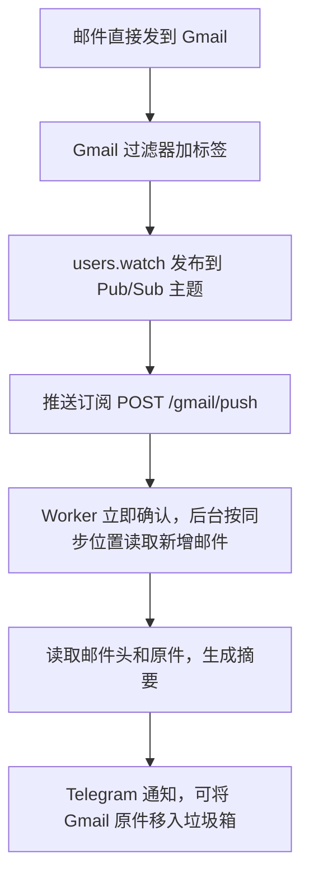

# Gmail 直收通知（可选）

有些服务不接受域名邮箱，只能填写 Gmail 地址。这类邮件直接投递到 Gmail，不经过 Email Routing。启用本功能后，Gmail 通过 Google Cloud Pub/Sub 推送变化通知，Worker 读取新邮件，沿用域名邮件的摘要、Telegram 通知和「删邮件+消息」按钮。原件已经在 Gmail 中，这条链路只读取，不再写入备份。

## 工作方式

Worker 用 `messages.insert` 写入的备份没有 `Delivered-To` 邮件头；Gmail 经 SMTP 收到的邮件带有 `Delivered-To: <Gmail 地址>`。Gmail 过滤器按 `deliveredto:` 给直收邮件加标签，Worker 只监听这个标签，备份邮件不会触发通知。



推送内容只用来唤醒同步。Worker 按 Gmail 历史记录逐封处理新增邮件，已处理的邮件按处理状态跳过；处理失败时同步位置不前进，下一次推送会重新拉取。这条链路不调用 Gmail 的写入接口，处理邮件不会引发新的推送循环。

## 准备

- 已按 [Gmail OAuth 设置](gmail-oauth-setup.md) 完成授权；现有 `gmail.modify` 权限可以读取邮件和建立监听，无需重新授权。
- OAuth 客户端所在的 Google Cloud 项目需要关联结算账号，Pub/Sub 才能使用。每封直收邮件只产生几条 1 KB 级别的推送，通常在 Pub/Sub 每月免费额度内，实际费用以 Google Cloud 账单为准。
- 已安装并登录 `gcloud`，或在 Google Cloud Console 中完成同样的操作。

下文 `YOUR_GCP_PROJECT_ID`、`YOUR_TOPIC`、`YOUR_SUBSCRIPTION`、`YOUR_GMAIL_ADDRESS`、`YOUR_GMAIL_LABEL` 和 Worker 地址均为占位符，替换为自己的值，不要提交到公开仓库。

## 1. 创建 Gmail 过滤器

1. 在 Gmail 搜索框输入 `deliveredto:YOUR_GMAIL_ADDRESS`，打开搜索选项，选择「创建过滤器」。
2. 勾选「应用标签」，新建一个标签，例如 `YOUR_GMAIL_LABEL`。嵌套标签的名称包含父级，例如 `父标签/子标签`。
3. 保存过滤器。过滤器只作用于之后收到的邮件。

被 Gmail 判为垃圾邮件，或被其他过滤器直接删除的直收邮件不会通知。

## 2. 创建 Pub/Sub 主题和推送订阅

先在当前终端生成推送 token，保存在 shell 变量中，第 3 步写入 Secret 时继续使用，不在屏幕上显示：

```bash
GMAIL_DIRECT_PUSH_SECRET=$(openssl rand -hex 32)
```

```bash
gcloud services enable pubsub.googleapis.com --project YOUR_GCP_PROJECT_ID
```

```bash
gcloud pubsub topics create YOUR_TOPIC --project YOUR_GCP_PROJECT_ID
```

允许 Gmail 向该主题发布通知：

```bash
gcloud pubsub topics add-iam-policy-binding YOUR_TOPIC --project YOUR_GCP_PROJECT_ID --member serviceAccount:gmail-api-push@system.gserviceaccount.com --role roles/pubsub.publisher
```

创建推送订阅。重试间隔为 10 至 600 秒指数退避，未确认的通知最多保留 10 分钟；直收邮件可能很久才有一封，订阅设为永不过期：

```bash
gcloud pubsub subscriptions create YOUR_SUBSCRIPTION --project YOUR_GCP_PROJECT_ID --topic YOUR_TOPIC --push-endpoint "https://<你的 Worker 地址>/gmail/push?token=${GMAIL_DIRECT_PUSH_SECRET}" --min-retry-delay 10s --max-retry-delay 600s --message-retention-duration 10m --expiration-period never
```

推送地址中的 token 会保存在订阅配置中，也可能出现在 Cloudflare 请求日志里。分享订阅配置或日志前先检查；泄露后更换 Secret，并用 `gcloud pubsub subscriptions modify-push-config` 更新推送地址。

## 3. 配置 Worker

在本机 `wrangler.jsonc` 的 `vars` 中加入：

```json
{
  "GMAIL_DIRECT_TOPIC": "projects/YOUR_GCP_PROJECT_ID/topics/YOUR_TOPIC",
  "GMAIL_DIRECT_LABEL": "YOUR_GMAIL_LABEL"
}
```

在同一个终端写入第 2 步生成的推送 token：

```bash
printf %s "$GMAIL_DIRECT_PUSH_SECRET" | pnpm exec wrangler secret put GMAIL_DIRECT_PUSH_SECRET
```

然后执行 `pnpm run deploy`。部署后 5 分钟内，Cron 调用 Gmail `users.watch` 建立监听，并在 KV 中记录监听状态和起始位置。监听最长 7 天有效，Cron 每天续期一次。

## 4. 验证

用其他邮箱向 Gmail 地址发一封测试邮件。确认 Gmail 中该邮件带有过滤器标签，Telegram 收到摘要；「删邮件+消息」会把 Gmail 中的这封原件移入垃圾箱。

## 停用

先删除 Pub/Sub 订阅和主题，再从 `vars` 中删除 `GMAIL_DIRECT_TOPIC` 并重新部署。之后推送入口返回 404，Cron 不再续期，现有监听最多 7 天后自然失效。只改配置不删订阅时，监听失效前的推送会收到 404 并按订阅设置重投。Gmail 过滤器可以保留或删除。

## 限制

- 只处理带过滤器标签、通过 SMTP 投递到 Gmail 的新邮件。过滤器建立之前的邮件、手动加标签的邮件不会通知。
- 本项目的兜底邮件发往这个 Gmail 时，带 `X-Processing-Id` 邮件头，原邮件已经通知过，直收链路会跳过它。
- 监听续期持续失败时，Telegram 每天最多告警一次；监听到期后直收邮件不再推送。恢复后的下一次推送会从原同步位置补齐，前提是同步位置仍有效。
- Gmail 历史记录通常至少保留一周。同步位置过期时，Worker 从当前位置重新开始并发送告警，此前未通知的直收邮件不会补发。
- 并发推送或 KV 最终一致可能导致同一封邮件重复通知，当前实现不提供严格的“恰好一次”保证。
